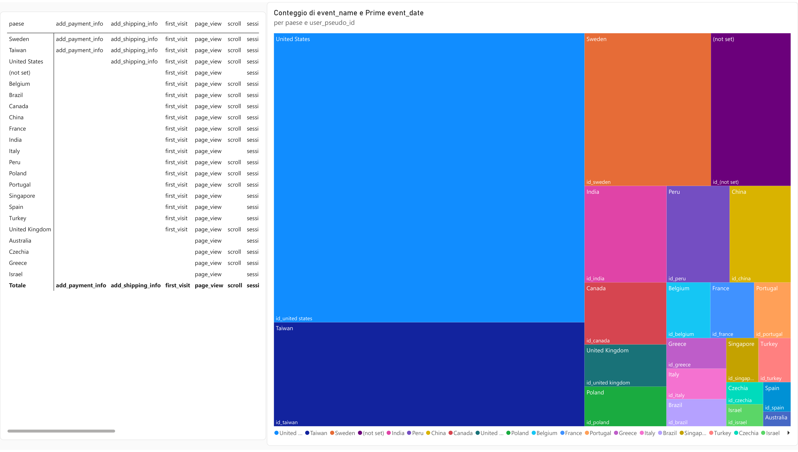
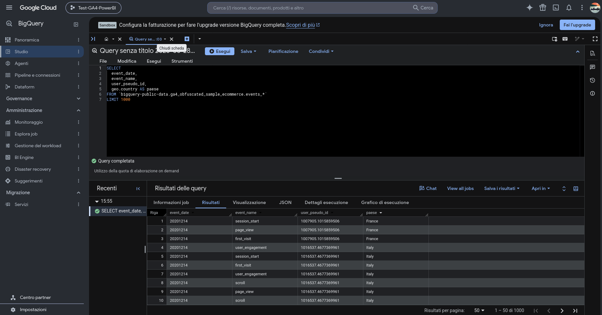

# GA4 → BigQuery → Power BI (esperimento con dati pubblici)

Esperimento personale per capire come viaggiano i dati di Google Analytics 4,
dall'export grezzo al report. Fatto fuori dal percorso ITS, senza dati di clienti.

## Perché è nato GA4
- **2005**: Google acquista Urchin, azienda di analisi web, e ne fa Google Analytics.
- **2012**: arriva Universal Analytics, lo strumento "classico" usato per anni.
- **2020**: esce GA4. Il mondo era cambiato: si naviga da mobile e dalle app,
  e le leggi sulla privacy (come il GDPR) sono diventate più rigide.
- **2023**: Universal Analytics smette di raccogliere dati.

Il 4 indica la quarta generazione. GA4 è stato ripensato da zero:
registra ogni azione dell'utente (un clic, uno scroll, un acquisto) come **evento**.
La sessione è uno degli eventi (`session_start`). GA4 ha anche un export nativo
verso BigQuery, che dà i dati grezzi, un evento per riga.

## Dati
Dataset pubblico e anonimizzato del **Google Merchandise Store**, il negozio online
di gadget di Google, messo a disposizione da Google per fare pratica:
`bigquery-public-data.ga4_obfuscated_sample_ecommerce`. Nessun dato di clienti.

## Il flusso, passo per passo
1. **GA4 (fonte)**: raccoglie gli eventi del sito.
2. **BigQuery (magazzino dati)**: con una query SQL ho estratto data, evento,
   utente (pseudonimo) e paese (`sql/query_eventi.sql`).
3. **Power Query (pulizia)**: ho caricato i dati in Power BI e li ho preparati:
   rinomina delle colonne, controllo dei tipi di dato, trasformazioni statistiche.
   Gli strumenti sono già pronti e si usano con pochi clic; per l'approccio a
   passaggi visuali mi ricorda strumenti come Dataiku.
4. **Power BI (visual)**: matrice paese × evento e treemap.

## Perché BigQuery e non il connettore diretto
Power BI ha un connettore diretto per GA4, che restituisce dati già aggregati.
Qui ho scelto BigQuery perché dà i dati grezzi per evento.

## Limiti
La query usa un campione di **1.000 righe**: i grafici servono a mostrare il flusso,
non a descrivere il negozio.

## Risultati
- **Misure DAX**: create metriche per il conteggio eventi e utenti unici.
- **Dashboard finale**: impaginati i report visuali con matrice e treemap.

## Screenshot

